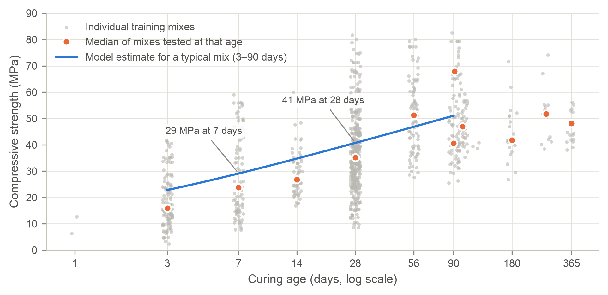
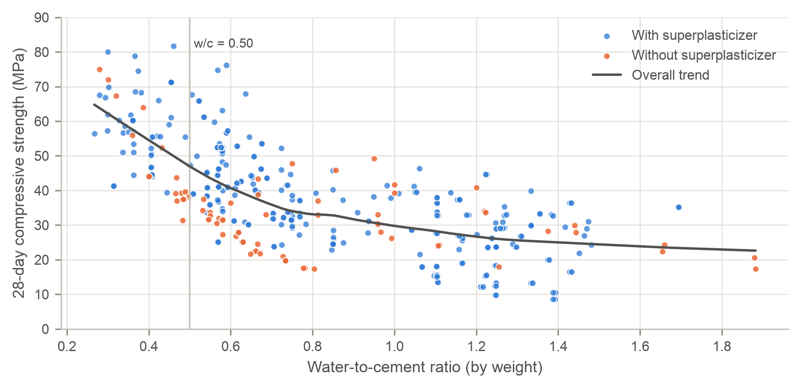
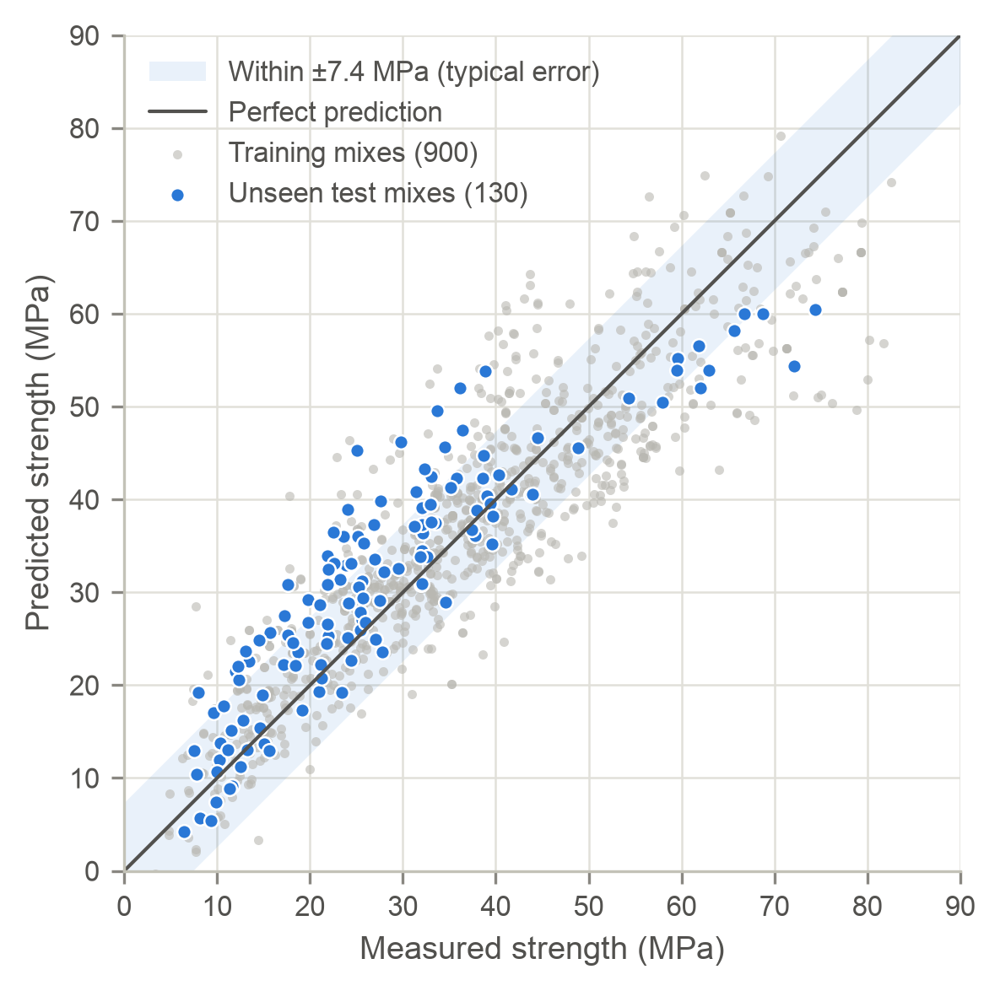

# Executive Summary

This report answers two questions for our client: can mix-design records predict how strong a batch of concrete will be, and which ingredients and practices matter most? We analyzed 1,030 laboratory-tested mixes. We built a prediction model from 900 and held back 130 as a blind test.

The final model explains about **76% of the batch-to-batch variation in strength** on those unseen mixes (R² = 0.76). Its predictions typically land within about 7.4 MPa of the measured strength. That is good enough to screen new mix designs and flag batches for closer attention, but not to replace cylinder testing.

## Key findings

- **Water is the strongest lever.** Removing 10 kg/m³ of water from a typical mix adds about 2.2 MPa. Every 28-day mix with a water-to-cement ratio of 0.50 or lower reached 30 MPa.
- **Cement helps, but less per kilogram.** An extra 50 kg/m³ of cement adds about 4.1 MPa.
- **Superplasticizer pays off by cutting water.** Mixes that used it held 26 kg/m³ less water and were 7.8 MPa stronger on average.
- **Curing time matters as much as the recipe.** A typical mix reaches only about 71% of its 28-day strength at 7 days.

## Primary recommendations

- Cap the water-to-cement ratio at 0.50 for structural grades.
- Reduce water with superplasticizer before adding cement.
- Use slag as a partial cement replacement, backed by trial batches.
- Approve a mix only when its predicted strength exceeds the specification by at least 11 MPa.

# Problem Context & Data Overview

**Business goals.** The client has three priorities. The first is structural safety and contract compliance: every delivered batch must meet its specified strength. The second is material cost, since cement is the most expensive and most carbon-intensive ingredient. The third is schedule, because curing time determines when formwork can be stripped. A reliable strength prediction supports all three by flagging risky mixes before they are poured.

## What each ingredient does

- **Cement** is the binder. It reacts with water to form a paste that glues the aggregates together.
- **Water** drives that reaction and makes the mix workable, but any excess leaves pores as it evaporates, weakening the concrete.
- **Blast furnace slag and fly ash** are industrial by-products that partly replace cement at lower cost and carbon, though they react more slowly.
- **Superplasticizer** is a chemical additive that makes concrete flow with less water.
- **Coarse and fine aggregates** (gravel and sand) fill most of the volume, adding bulk and stiffness at low cost.
- **Age** is the curing time in days; strength keeps rising as curing continues, and 28 days is the standard acceptance age.

**The data.** Each of the 1,030 mixes records seven ingredient quantities (kg per m³ of concrete), the curing age in days, and the measured compressive strength in megapascals (1 MPa ≈ 145 psi). Rows 501–630 (130 mixes) formed the blind test. Table 1 summarizes the 900 mixes used to build the model. The mixes span a wide range of recipes: cement varies five-fold, many mixes contain no slag, fly ash or superplasticizer, and strength runs from 2 to 83 MPa.

Table: **Table 1.** Descriptive statistics of the 900 training mixes (sample standard deviation).

| Variable | Unit | Mean | Std. Dev. | Min | Max |
|:---|:---|---:|---:|---:|---:|
| Cement | kg/m³ | 277.87 | 106.00 | 102.00 | 540.00 |
| Blast Furnace Slag | kg/m³ | 76.11 | 84.07 | 0.00 | 305.30 |
| Fly Ash | kg/m³ | 57.38 | 64.26 | 0.00 | 200.10 |
| Water | kg/m³ | 180.72 | 22.28 | 121.75 | 247.00 |
| Superplasticizer | kg/m³ | 6.86 | 5.98 | 0.00 | 32.20 |
| Coarse Aggregate | kg/m³ | 973.76 | 77.57 | 801.00 | 1,145.00 |
| Fine Aggregate | kg/m³ | 772.33 | 81.91 | 594.00 | 992.60 |
| Age | days | 46.04 | 61.32 | 1.00 | 365.00 |
| Compressive Strength | MPa | 36.93 | 16.65 | 2.33 | 82.60 |

Two relationships stand out. Figure 1 shows that strength climbs steeply over the first four weeks and then levels off. Figure 2 shows the classic water-to-cement effect: 28-day strength falls steadily as the ratio rises, and mixes made with superplasticizer cluster at the stronger, drier end.

{width=6.1in}

{width=6.1in}

# Model Reliability & Analytical Findings

**How the model works.** A simple straight-line model links strength directly to the amount of each ingredient. The final model instead works with *proportional* changes, so a 10% change counts the same whether the mix is lean or rich. This matches how concrete behaves: proportions such as water-to-cement drive strength, and gains slow down with age.

**Reliability on unseen mixes.** Table 2 compares both approaches. The final model explained 80% of the variation in the training mixes and 76% in the unseen mixes, a small drop showing that it holds up on new recipes, while the simple model fell from 62% to 37%. As Figure 3 shows, 81% of unseen mixes were predicted within 10 MPa. However, the model **over-predicted unseen mixes by 3.4 MPa on average**. Those mixes used superplasticizer far less often than the training mixes (24% versus 69%), so we recommend a safety margin below.

Table: **Table 2.** Model accuracy on the 900 training mixes and 130 unseen test mixes. Typical error is the usual size of a prediction miss.

| Model | Variation explained (training) | Variation explained (unseen) | Typical error, unseen (MPa) | Unseen within 10 MPa |
|:---|---:|---:|---:|---:|
| Simple straight-line model | 62% | 37% | 11.9 | 65% |
| **Final model** | **80%** | **76%** | **7.4** | **81%** |

{width=3.7in}

**What each ingredient is worth.** Table 3 translates the model into real-world effects for a typical mix: 263 kg/m³ cement, 42 kg/m³ slag, no fly ash, 182 kg/m³ water and 7.4 kg/m³ superplasticizer, with a predicted strength of 40.7 MPa at 28 days. Holding all other components constant, **adding 50 kg/m³ of cement yields an estimated 4.1 MPa increase**. Removing 10 kg/m³ of water yields 2.2 MPa, so kilogram for kilogram, cutting water is about 2.6 times as effective as adding cement. Within the ranges studied, fly ash and aggregate quantities had no reliable effect on strength.

Table: **Table 3.** Estimated strength change from adjusting the typical mix, all else held constant; evidence reflects how consistently each effect appears.

| Adjustment to the typical mix | Change (MPa) | Evidence |
|:---|---:|:---|
| Add 50 kg/m³ cement | +4.1 | Strong |
| Remove 10 kg/m³ water | +2.2 | Strong |
| Remove 26 kg/m³ water (typical saving with superplasticizer) | +5.9 | Strong |
| Add 50 kg/m³ blast furnace slag | +1.8 | Strong |
| Replace 50 kg/m³ cement with slag (at 28 days) | −3.2 | Strong |
| Add 5 kg/m³ superplasticizer (no change in water) | +0.9 | Strong |
| Add 50 kg/m³ fly ash | +0.8 | Weak (not reliable) |
| Add 50 kg/m³ coarse or fine aggregate | under ±0.5 | Weak (not reliable) |
| Cure 28 days instead of 7 | +11.6 | Strong |
| Cure 56 days instead of 28 | +6.1 | Strong |

## Key physical interactions

- **The water-to-cement trade-off.** Table 4 groups the 28-day mixes by water-to-cement ratio. At or below 0.50, every mix reached 30 MPa; above 0.80, the median was only 27 MPa. Counting slag and fly ash as binder tracks strength even more closely, which confirms that they do part of cement's job.
- **Superplasticizer works through water.** On its own it adds only about 0.9 MPa. Its real value is the 26 kg/m³ of water it lets crews remove, which is worth about 5.9 MPa.
- **Slag needs time.** Swapping cement for slag costs some 28-day strength, but slag mixes were stronger than slag-free mixes at every age, and the gap widened after 28 days.

Table: **Table 4.** 28-day strength of the 384 training mixes tested at 28 days, by water-to-cement ratio.

| Water-to-cement ratio | Mixes | Median (MPa) | Weakest 10% below (MPa) | Reached 30 MPa | Reached 40 MPa |
|:---|---:|---:|---:|---:|---:|
| 0.40 or less | 34 | 60.3 | 44.1 | 100% | 100% |
| 0.40 to 0.50 | 32 | 50.5 | 37.5 | 100% | 72% |
| 0.50 to 0.60 | 69 | 41.1 | 31.8 | 96% | 58% |
| 0.60 to 0.80 | 89 | 33.4 | 23.6 | 75% | 35% |
| above 0.80 | 160 | 27.5 | 14.9 | 37% | 7% |

# Strategic Recommendations & Implementation Plan

## Operational rules

1. **Cap the water-to-cement ratio at 0.50 for structural grades and at 0.40 for high-strength work.** In the data, every 28-day mix at or below 0.50 reached 30 MPa, and every mix at or below 0.40 reached 40 MPa (Table 4).
2. **Cut water with superplasticizer before adding cement.** Removing 26 kg/m³ of water is worth about 5.9 MPa, more than an extra 50 kg/m³ of cement (4.1 MPa), without that cement's cost and carbon. Confirm workability with a slump test whenever the dosage changes.
3. **Use slag as a partial cement substitute, paired with less water.** Each 50 kg/m³ of cement replaced by slag costs about 3.2 MPa at 28 days, and removing roughly 15 kg/m³ of water recovers it. Where the schedule allows, specify 56-day acceptance for slag-rich mixes.
4. **Use 7-day results as an early warning.** A typical mix reaches about 71% of its 28-day strength at 7 days. A 7-day cylinder below 70% of the 28-day target should trigger a hold on dependent work and an investigation.

## Risk mitigation

The model leaves about a quarter of the variation unexplained. It comes from factors the data does not record: cement type, aggregate source and moisture, temperature, humidity, curing practice and testing variability. The data also comes from a single laboratory study, so the client's local aggregates may behave differently.

- **Calibrate locally first:** run 20–30 trial batches with the client's own materials and compare them with the model before relying on it.
- **Keep a safety margin:** approve a mix only if its prediction beats the specification by 11 MPa or more (the 7.4 MPa typical error plus the 3.4 MPa average over-prediction).
- **Stay inside the tested ranges** in Table 1, and never extrapolate past 90 days of curing.
- **Never accept a batch on the prediction alone.** Cylinder tests remain the acceptance criterion.

## Continuous monitoring framework

- **Record every batch:** the mix proportions, the model's 7- and 28-day predictions, and the cylinder results.
- **Chart the gap** between measured and predicted strength: investigate gaps over 15 MPa and stop work above 22 MPa (two and three times the typical error).
- **Watch for drift:** recalibrate if the average gap over the last 30 batches exceeds ±3 MPa, or if fewer than 75% of batches fall within 10 MPa (today's benchmark is 81%).
- **Refit the model quarterly**, and immediately after any change of cement, admixture or aggregate supplier. The quality-assurance manager should review the dashboard monthly.
