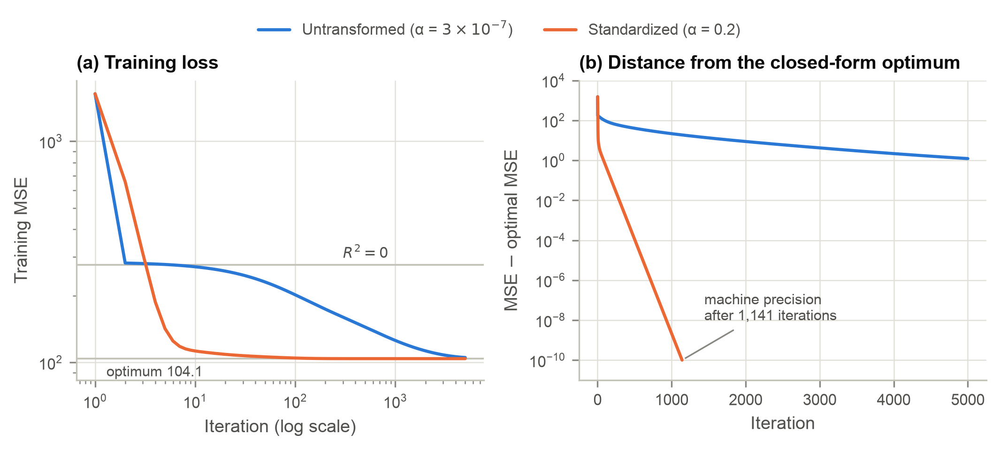
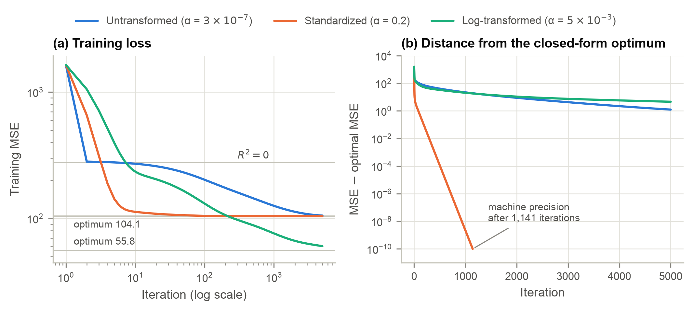
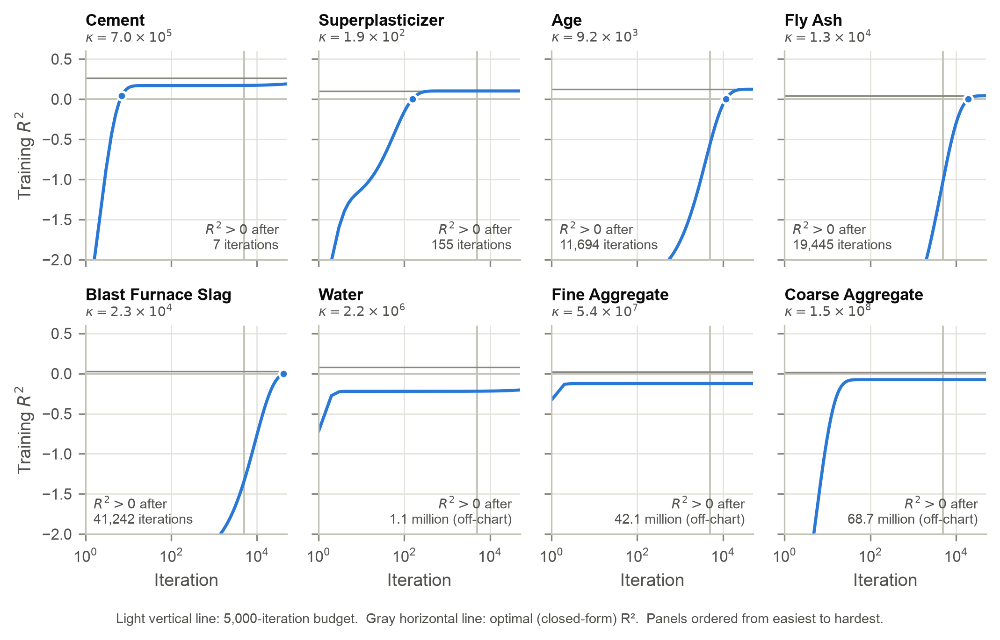
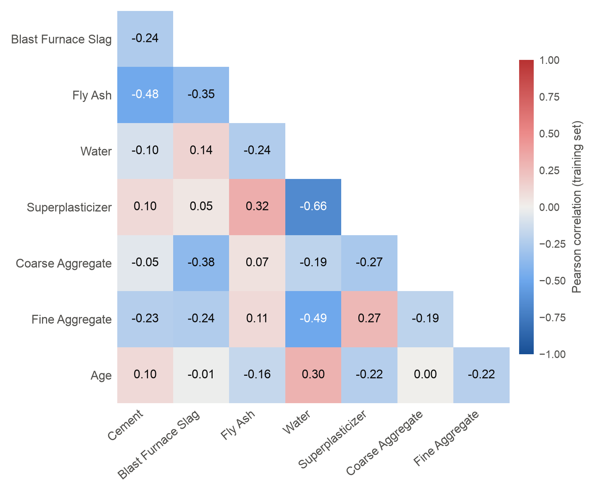

# Algorithmic Design & Implementation Details

**Objective.** Each training example is a predictor vector $\mathbf{x}_i \in \mathbb{R}^{p}$ ($p = 8$) with measured strength $y_i$. We prepend a column of ones, giving the design matrix $Z = [\mathbf{1}\;\, X] \in \mathbb{R}^{n \times (p+1)}$, so the intercept is simply $\theta_0$ in $\boldsymbol\theta = (b, w_1, \dots, w_p)^\top$. A univariate model is the case $p = 1$, with $\boldsymbol\theta = (b, m)^\top$. The objective is the training mean squared error:

$$J(\boldsymbol\theta) = \frac{1}{n}\sum_{i=1}^{n}\left(\mathbf{z}_i^\top\boldsymbol\theta - y_i\right)^2 = \frac{1}{n}\left\lVert Z\boldsymbol\theta - \mathbf{y}\right\rVert_2^2 .$$

**Gradient.** Differentiating the squared residuals term by term gives

$$\frac{\partial J}{\partial \theta_j} = \frac{2}{n}\sum_{i=1}^{n}\left(\mathbf{z}_i^\top\boldsymbol\theta - y_i\right) z_{ij} \quad\Longrightarrow\quad \nabla J(\boldsymbol\theta) = \frac{2}{n}\, Z^\top\!\left(Z\boldsymbol\theta - \mathbf{y}\right).$$

In the univariate case the two components are $\partial J/\partial b = \frac{2}{n}\sum_i (m x_i + b - y_i)$ and $\partial J/\partial m = \frac{2}{n}\sum_i (m x_i + b - y_i)\,x_i$. Parameters start at zero and follow the update rule

$$\boldsymbol\theta^{(t+1)} = \boldsymbol\theta^{(t)} - \alpha\,\nabla J\!\left(\boldsymbol\theta^{(t)}\right), \qquad \boldsymbol\theta^{(0)} = \mathbf{0}.$$

**Why the step size is bounded.** $J$ is quadratic with constant Hessian $H = \frac{2}{n}Z^\top Z$, so the error evolves exactly as $\boldsymbol\theta^{(t)} - \boldsymbol\theta^\star = (I - \alpha H)^t(\boldsymbol\theta^{(0)} - \boldsymbol\theta^\star)$. Gradient descent therefore converges if and only if $0 < \alpha < 2/\lambda_{\max}(H)$. The slowest eigendirection shrinks by a factor $|1 - \alpha\lambda_{\min}|$ per iteration, which is about $1 - 2/\kappa$ at the largest stable step, where $\kappa = \lambda_{\max}/\lambda_{\min}$ is the condition number. This bound guides every hyperparameter choice below.

```text
GRADIENT-DESCENT(X, y, α, T, ε)
    Z ← [1 | X]              // n × (p+1); column 1 is the intercept
    θ ← 0                    // length p+1
    for t ← 0 … T−1:
        r ← Zθ − y           // residuals
        J[t] ← (1/n) rᵀr     // record training MSE
        g ← (2/n) Zᵀr        // gradient ∇J(θ)
        θ ← θ − α g          // parameter update
        if t > 0 and |J[t−1] − J[t]| < ε:  break
    return θ, J
```

**Implementation notes.** This is full-batch gradient descent: every update uses all 900 training rows, so each iteration costs two matrix–vector products, $O(np)$. Because nothing is sampled, runs are deterministic. The loss is recorded before each update, so the first entry is the loss at $\boldsymbol\theta = \mathbf{0}$: an MSE of 1,640.6, which is $R^2 = -4.92$ on the training set. The repository contains two copies of the algorithm. One is a reusable function in `utils/grad_descent.py`, wrapped by `models/linear.py` for univariate and multivariate models. The other is inlined in the self-contained scripts so they can run outside the repository. Both implement exactly the pseudocode above.

**Hyperparameters.** Table 1 lists the settings. For each feature set we tried learning rates on a powers-of-ten grid, kept the largest value that converged, and confirmed it against the theoretical limit $2/\lambda_{\max}$. Every reported run uses a fixed budget of $T = 5{,}000$ iterations with the tolerance disabled ($\varepsilon = 0$), so all loss curves span the same horizon. The library version in `utils/grad_descent.py` also supports early stopping at $\varepsilon = 10^{-8}$ for exploratory runs.

Table: **Table 1.** Gradient descent hyperparameters and the conditioning of each problem. $\kappa(H)$ is the condition number of the MSE Hessian, including the intercept column.

| Configuration | Learning rate $\alpha$ | Limit $2/\lambda_{\max}$ | $\kappa(H)$ | Max iterations | Stopping rule |
|:---|---:|---:|---:|---:|:---|
| Untransformed | $3\times10^{-7}$ | $5.99\times10^{-7}$ | $1.18\times10^{10}$ | 5,000 | fixed budget |
| Standardized | $0.2$ | $0.427$ | $86.8$ | 5,000 | fixed budget |
| Log-transformed | $5\times10^{-3}$ | $5.68\times10^{-3}$ | $1.63\times10^{7}$ | 5,000 | fixed budget |
| Univariate models | Table 5 | Table 5 | Table 5 | 5,000 | fixed budget |

**Environment and data partition.** All results were produced with Python 3.12.15 on macOS (arm64), using NumPy 2.5.4, pandas 3.0.6, scikit-learn 1.9.1, statsmodels 0.15.0, matplotlib 3.11.2 and xlrd 2.0.2. Gradient descent uses only NumPy matrix operations. scikit-learn provides `StandardScaler` and the closed-form `LinearRegression` baselines, and statsmodels provides `OLS` p-values. The partition is deterministic, with no shuffling:

1. Read `Concrete_Data.xls` with `pandas.read_excel` (1,030 rows; 8 predictors and the target).
2. Test set: rows 501–630 in 1-indexed numbering (`df.iloc[500:630]`, 130 rows).
3. Training set: all other rows (`pd.concat([df.iloc[:500], df.iloc[630:]])`, 900 rows).
4. Standardization parameters $\mu_j, \sigma_j$ are estimated on the training rows only, as $\tilde{x}_{ij} = (x_{ij}-\mu_j)/\sigma_j$. The log transform $x'_{ij} = \ln(x_{ij}+1)$ has no fitted parameters. Test rows never influence any parameter.

We evaluate with $\mathrm{MSE} = \frac{1}{n}\sum_i (y_i - \hat{y}_i)^2$ and $R^2 = 1 - \mathrm{MSE}/\mathrm{Var}(y)$, where $\mathrm{Var}(y)$ is computed on the split being scored.

# Feature Scaling & Gradient Descent Dynamics

**Scaling and convergence speed.** We trained the multivariate model on raw and on standardized features. Both reached a positive $R^2$ almost immediately, after 5 and 3 updates respectively (Table 2), and finished at training $R^2$ values of 0.620 and 0.624. Their behavior then diverged sharply, as Figure 1 shows. The standardized run came within 1% of the optimal loss after 79 iterations and matched it to machine precision after 1,141. After 5,000 iterations the raw run was still 1.2% above the optimal loss. More tellingly, its intercept had barely moved from zero (the optimum is $-51.43$): the loss was nearly converged, but the parameters were not.

{width=6.5in}

Table: **Table 2.** Gradient descent fits after 5,000 iterations, scored with MSE and $R^2$ on both splits. Table 4 gives the closed-form optima for comparison.

| Configuration | Updates to $R^2>0$ | Updates to within 1% of optimum | Train MSE | Train $R^2$ | Test MSE | Test $R^2$ |
|:---|---:|---:|---:|---:|---:|---:|
| Untransformed | 5 | not reached | 105.37 | 0.620 | 139.93 | 0.375 |
| Standardized | 3 | 79 | 104.14 | 0.624 | 141.31 | 0.368 |
| Log-transformed | 7 | not reached | 60.40 | 0.782 | 48.63 | 0.783 |

The cause is conditioning. Raw predictors differ in scale by two orders of magnitude (superplasticizer averages 6.9 kg/m³, coarse aggregate 974 kg/m³), and their large uncentered means make them nearly collinear with the intercept column. The result is $\kappa = 1.18\times10^{10}$. The largest eigenvalue caps the step at $\alpha < 5.99\times10^{-7}$. At that step, the smallest-eigenvalue direction (almost exactly the intercept) contracts by a factor of only $1 - 8.5\times10^{-11}$ per iteration. Standardizing centers each column and equalizes the scales, bringing $\kappa$ down to 86.8 and allowing a step roughly $10^{6}$ times larger.

Stability follows the same bound. In a sweep at $0.5$, $0.9$, $0.99$, $1.01$ and $1.1$ times $2/\lambda_{\max}$, every feature set converged at $0.99\times$ and diverged at $1.01\times$, where the training MSE overflowed past $10^{85}$. Scaling therefore does not make gradient descent stable on its own. It makes the stable region wide enough that a reasonable step converges quickly.

**Scaling and the optimal solution.** We fit both feature sets with scikit-learn's closed-form `LinearRegression`. The coefficients differ (Table 3), but dividing each standardized weight by its feature's training standard deviation recovers the untransformed weight exactly. The two models' test predictions agree to within $10^{-13}$ MPa, and their MSE and $R^2$ are identical (Table 4). A linear transformation only reparameterizes the same fitted function:

$$\hat{y} = \tilde{b} + \sum_j \tilde{w}_j\,\frac{x_j-\mu_j}{\sigma_j} = \Big(\tilde{b} - \sum_j \tilde{w}_j\,\mu_j/\sigma_j\Big) + \sum_j \big(\tilde{w}_j/\sigma_j\big)\,x_j .$$

The optimum does not change in any meaningful way; only its coordinates do.

Table: **Table 3.** Closed-form coefficients for each feature set. Column 4 rescales the standardized weights back to raw units.

| Feature | Untransformed $w_j$ | Standardized $\tilde{w}_j$ | $\tilde{w}_j/\sigma_j$ | Log-transformed |
|:---|---:|---:|---:|---:|
| Cement | 0.1324 | 14.0319 | 0.1324 | 23.6163 |
| Blast Furnace Slag | 0.1247 | 10.4806 | 0.1247 | 2.3034 |
| Fly Ash | 0.1061 | 6.8172 | 0.1061 | 0.1967 |
| Water | −0.1341 | −2.9858 | −0.1341 | −38.3340 |
| Superplasticizer | 0.1172 | 0.7009 | 0.1172 | 1.8738 |
| Coarse Aggregate | 0.0285 | 2.2131 | 0.0285 | 4.1940 |
| Fine Aggregate | 0.0338 | 2.7698 | 0.0338 | −6.6464 |
| Age | 0.1188 | 7.2809 | 0.1188 | 9.0345 |
| Intercept | −51.4295 | 36.9268 | — | 81.0016 |

# Linear vs. Non-Linear Feature Transformations

**Approach.** We applied $x' = \ln(x+1)$ elementwise to all eight predictors; the $+1$ keeps zero dosages finite. We trained the model with our gradient descent at $\alpha = 5\times10^{-3}$, just below the limit of $5.68\times10^{-3}$, and computed the optimum with `LinearRegression`.

**Convergence and stability.** Figure 2 adds the log-transformed run. Its condition number ($1.63\times10^{7}$) is three orders of magnitude smaller than the raw features' but five orders larger than the standardized features'. Its convergence falls between the two: it permits steps about $10^{4}$ times larger than the raw model and passes the raw model's optimal loss within about 200 iterations. It was still 8.2% above its own optimum after 5,000 iterations. The log compresses each feature's range but does not center it. For example, $\ln(\text{coarse aggregate}+1)$ only spans 6.69–7.04, so it is almost a constant column and nearly collinear with the intercept. Standardizing after the log transform would remove this problem. Stability behaved exactly as for the other feature sets, with a sharp threshold at $2/\lambda_{\max}$.

{width=6.5in}

Table: **Table 4.** Summary of the three closed-form optimal models (scikit-learn `LinearRegression`).

| Model | Training MSE | Testing MSE | Training $R^2$ | Testing $R^2$ |
|:---|---:|---:|---:|---:|
| Untransformed | 104.1437 | 141.3139 | 0.6240 | 0.3685 |
| Standardized | 104.1437 | 141.3139 | 0.6240 | 0.3685 |
| Log-transformed | 55.8324 | 54.3849 | 0.7984 | 0.7570 |

**Impact on the optimal solution.** Two separate effects are easy to conflate here. For each feature representation, the MSE objective is convex and the closed-form solution is its global minimizer. Differences in Table 4 therefore reflect what each model can express, while differences in Figures 1 and 2 reflect only how quickly gradient descent reaches that minimizer. Unlike standardization, the log transform changes the function class, not just its coordinates. The model becomes $\hat{y} = b + \sum_j w_j \ln(x_j+1)$, which is multiplicative in the raw inputs. The cement and water terms can be rewritten as $23.6\ln C - 38.3\ln W = 23.6\ln(C/W) - 14.7\ln W$, which shows that most of their effect runs through the water-to-cement ratio, consistent with Abrams' law. The age term now describes strength gains that slow over time. Table 4 shows the consequences: training $R^2$ rises from 0.624 to 0.798, and testing $R^2$ from 0.369 to 0.757. The train–test gap shrinks from 0.256 to 0.041.

The improvement on test data is larger than on training data because the held-out rows differ from the training rows. Only 24% of test mixes contain superplasticizer (69% in training), and their mean strength is 28.1 MPa versus 36.9 MPa. A raw linear model extrapolates these differences proportionally, whereas the log scale dampens them. As an aside, the early-stopped gradient descent log model scored a slightly higher test $R^2$ (0.783) than its closed-form optimum, a mild implicit-regularization effect. The summary table nonetheless reports the optimum, as required.

# Univariate vs. Multivariate Model Dynamics

**Approach.** We trained eight univariate models $y = m_i x_i + b$, one per raw predictor. Each used the largest learning rate of the form $\{1, 2, 5\}\times10^{k}$ below its own $2/\lambda_{\max}$, starting from $\boldsymbol\theta = \mathbf{0}$, with the 5,000-iteration budget. An extended 50,000-iteration run tracked the slower models. Where even that budget was insufficient, we computed the exact number of updates needed from the closed-form recursion $(I-\alpha H)^t$ given above; it reproduces the observed counts wherever both are available. Results appear in Table 5 and Figure 3.

Table: **Table 5.** Univariate gradient descent on raw predictors (training set), ordered from easiest to hardest. "Optimal" is the closed-form `LinearRegression` fit. † Updates computed from the gradient descent recursion because they exceed the 50,000-iteration run.

| Predictor | $\kappa(H)$ | $\alpha$ | MSE after 5,000 | $R^2$ after 5,000 | Optimal MSE | Optimal $R^2$ | Updates to $R^2>0$ |
|:---|---:|---:|---:|---:|---:|---:|---:|
| Cement | $7.0\times10^{5}$ | $1\times10^{-5}$ | 229.7 | 0.171 | 203.8 | 0.264 | 7 |
| Superplasticizer | $1.9\times10^{2}$ | $1\times10^{-2}$ | 248.8 | 0.102 | 248.8 | 0.102 | 155 |
| Age | $9.2\times10^{3}$ | $1\times10^{-4}$ | 431.5 | −0.558 | 243.0 | 0.123 | 11,694 |
| Fly Ash | $1.3\times10^{4}$ | $1\times10^{-4}$ | 557.7 | −1.013 | 265.3 | 0.042 | 19,445 |
| Blast Furnace Slag | $2.3\times10^{4}$ | $5\times10^{-5}$ | 647.9 | −1.339 | 270.0 | 0.025 | 41,242 |
| Water | $2.2\times10^{6}$ | $2\times10^{-5}$ | 337.9 | −0.220 | 255.8 | 0.077 | 1,135,437† |
| Fine Aggregate | $5.4\times10^{7}$ | $1\times10^{-6}$ | 311.5 | −0.124 | 270.7 | 0.023 | 42,114,806† |
| Coarse Aggregate | $1.5\times10^{8}$ | $1\times10^{-6}$ | 298.0 | −0.076 | 272.5 | 0.016 | 68,748,264† |

{width=6.5in}

**Easy versus hard.** Only cement and superplasticizer reached a positive $R^2$ within the budget, which satisfies the requirement of at least two. Superplasticizer converged fully. Age, fly ash and slag needed $10^{4}$–$4\times10^{4}$ iterations, water about $1.1\times10^{6}$, and the two aggregates more than $4\times10^{7}$. Difficulty is explained by conditioning. For $Z = [\mathbf{1}\;\,\mathbf{x}]$, with training mean $\bar{x}$ and standard deviation $s$,

$$H = 2\begin{pmatrix} 1 & \bar{x} \\ \bar{x} & \bar{x}^2 + s^2 \end{pmatrix}, \qquad \kappa(H) \approx \frac{(1 + \bar{x}^2 + s^2)^2}{s^2} \quad (\bar{x}^2 + s^2 \gg 1),$$

so predictors with a large mean relative to their spread are hardest. The aggregates have $\bar{x}/s \approx 9$ to $13$, compared with about 1 for superplasticizer.

The direction of the true slope also matters. Starting from zero, the fast eigendirection mostly scales $x$, so gradient descent first fits $\hat{y} \approx m x$ through the origin. For cement, whose true slope is positive, this alone already beats the mean. For predictors whose optimal slope is negative, the early fit is wrong-signed: after 5,000 iterations water's slope was $+0.197$ against an optimum of $-0.207$, and fly ash and both aggregates showed the same reversal. Their $R^2$ stays negative until the slowly moving intercept catches up.

**Coefficients.** The univariate and multivariate coefficients are not identical (Table 6); three even reverse sign (fly ash and both aggregates). The gap has an exact in-sample decomposition. Multivariate residuals are uncorrelated with every predictor, so each univariate slope equals

$$\hat{b}_j^{\,\mathrm{uni}} = \frac{\widehat{\mathrm{Cov}}(x_j, y)}{\widehat{\mathrm{Var}}(x_j)} = \hat\beta_j + \sum_{k \neq j} \hat\beta_k\,\frac{\widehat{\mathrm{Cov}}(x_j, x_k)}{\widehat{\mathrm{Var}}(x_j)} .$$

The sum is the omitted-variable bias: a univariate model credits $x_j$ with the effects of every correlated predictor it omits. Figure 4 shows those correlations. Fly ash tends to replace cement ($r = -0.48$), so its univariate slope absorbs the missing cement effect ($-0.105$) and turns negative. Superplasticizer's univariate slope (0.888) is 7.6 times its multivariate weight, because superplasticized mixes also contain more fly ash ($+0.367$) and much less water ($r = -0.66$, $+0.329$).

Table: **Table 6.** Optimal univariate slopes versus optimal multivariate weights (untransformed, scikit-learn). The omitted-variable term is the sum in the decomposition above, and the last column names its largest single component.

| Feature | Univariate $\hat{b}_j$ | Multivariate $\hat\beta_j$ | Omitted-variable term | Largest contributor |
|:---|---:|---:|---:|:---|
| Cement | 0.0808 | 0.1324 | −0.0517 | Fly Ash (−0.031) |
| Blast Furnace Slag | 0.0316 | 0.1247 | −0.0931 | Cement (−0.041) |
| Fly Ash | −0.0534 | 0.1061 | −0.1596 | Cement (−0.105) |
| Water | −0.2070 | −0.1341 | −0.0729 | Age (+0.098) |
| Superplasticizer | 0.8881 | 0.1172 | +0.7709 | Fly Ash (+0.367) |
| Coarse Aggregate | −0.0274 | 0.0285 | −0.0559 | Blast Furnace Slag (−0.051) |
| Fine Aggregate | −0.0306 | 0.0338 | −0.0644 | Cement (−0.039) |
| Age | 0.0952 | 0.1188 | −0.0236 | Cement (+0.023) |

{width=4.8in}

# Statistical Inference & Regression Analysis

**Approach.** For each feature set we fit `statsmodels.api.OLS` with `add_constant` on the 900 training rows and extracted two-sided $t$-test p-values, consolidated in Table 7:

$$t_j = \frac{\hat\beta_j}{\widehat{\mathrm{SE}}(\hat\beta_j)}, \qquad \widehat{\mathrm{SE}}(\hat\beta_j) = \sqrt{\hat\sigma^2\,\big[(Z^\top Z)^{-1}\big]_{jj}}, \qquad \hat\sigma^2 = \frac{\lVert \mathbf{y} - Z\hat{\boldsymbol\beta} \rVert^2}{n - p - 1}.$$

Table: **Table 7.** Feature p-values for the three multivariate configurations (two-sided $t$-tests, 891 residual degrees of freedom). n.s. = not significant at $\alpha = 0.05$.

| Feature | Untransformed | Standardized | Log-transformed |
|:---|---:|---:|---:|
| Cement | $2.5\times10^{-40}$ | $2.5\times10^{-40}$ | $1.0\times10^{-85}$ |
| Blast Furnace Slag | $6.4\times10^{-26}$ | $6.4\times10^{-26}$ | $7.0\times10^{-36}$ |
| Fly Ash | $3.3\times10^{-13}$ | $3.3\times10^{-13}$ | 0.292 (n.s.) |
| Water | $1.8\times10^{-3}$ | $1.8\times10^{-3}$ | $1.7\times10^{-20}$ |
| Superplasticizer | 0.243 (n.s.) | 0.243 (n.s.) | $8.4\times10^{-6}$ |
| Coarse Aggregate | $5.6\times10^{-3}$ | $5.6\times10^{-3}$ | 0.405 (n.s.) |
| Fine Aggregate | $3.0\times10^{-3}$ | $3.0\times10^{-3}$ | 0.089 (n.s.) |
| Age | $8.6\times10^{-74}$ | $8.6\times10^{-74}$ | $1.8\times10^{-192}$ |

**Importance versus ease of training.** No consistent trend links the two. Cement is both highly significant and easy to train. Age, however, is the most significant predictor in every configuration yet needed 11,694 iterations. Superplasticizer is the easiest univariate model but is not significant in the untransformed multivariate model. The aggregates, which have the weakest significant effects, are also the hardest to train, but that reflects their $\bar{x}/s$ ratio, not their importance. Ease of training depends on the geometry of the univariate loss surface (scale, centering and the sign of the marginal slope). Significance measures a predictor's conditional contribution once all the others are included.

**Which transformation changes significance.** Standardization leaves every p-value unchanged. Rescaling $x_j \to (x_j - \mu_j)/\sigma_j$ multiplies both $\hat\beta_j$ and $\widehat{\mathrm{SE}}(\hat\beta_j)$ by $\sigma_j$, and the intercept absorbs the shift, so $t_j$ is invariant. The log transform changes significance drastically. Fly ash moves from $3.3\times10^{-13}$ to 0.29, superplasticizer from 0.24 to $8.4\times10^{-6}$, water from $1.8\times10^{-3}$ to $1.7\times10^{-20}$, and both aggregates lose significance. A non-linear transform changes the hypothesis being tested (the effect of a proportional rather than an absolute change), the collinearity among predictors, and the residual variance, which falls from $\hat\sigma^2 = 105.2$ to 56.4. The p-values are therefore properties of the model specification, not fixed attributes of the ingredients.

# Code & Reproducibility Access

The full implementation is available at **<https://github.com/brian-j-wei/data_mining_proj_1>**. Every computation is deterministic: full-batch gradient descent from a zero initialization, a fixed train/test split, and closed-form baselines. Rerunning the scripts therefore reproduces every number exactly. The only random element is the horizontal jitter of points in the client report's age figure, which uses a fixed seed. From the repository root, the following commands reproduce every figure and table in this appendix and in the client report. Table 8 maps each script to the results it produces.

```bash
conda create -n dm_2026 python=3.12 && conda activate dm_2026
pip install -r requirements.txt
bash run_all.sh            # every analysis script, in order (< 1 min)

# optional: rebuild the two reports (needs pandoc)
conda install pandoc && pip install -r reports/requirements.txt
python reports/build_reports.py

# optional: ad hoc runs at other learning rates, or one feature
python -m scripts.train --transform standardized --lr 0.01 --iters 5000
python -m scripts.train --feature Cement --lr 1e-5 --iters 5000
```

Table: **Table 8.** Scripts and the results they reproduce. Figures are written to `assets/figures/`, tables to `assets/tables/`.

| Script | Reproduces |
|:---|:---|
| `utils/grad_descent.py`, `models/linear.py` | Gradient descent implementation; univariate and multivariate wrappers |
| `scripts/gradient_descent_self_contained.py` | Self-contained gradient descent, untransformed vs. standardized loss curves |
| `scripts/log_transformation.py` | Self-contained gradient descent with all three feature sets |
| `scripts/convergence_diagnostics.py` | Tables 1–2, learning-rate sweep, Figures 1–2 |
| `scripts/optimal_coefficients.py` | Table 3 |
| `scripts/summary_table.py` | Table 4 |
| `scripts/univariate_gradient_descent.py` | Table 5, Figure 3 |
| `scripts/univariate_vs_multivariate.py` | Table 6, Figure 4 |
| `scripts/pvalues.py` | Table 7 |
| `scripts/descriptive_stats.py`, `scripts/client_insights.py` | Client report tables and figures |
| `scripts/train.py`, `scripts/eval.py` | Command-line interface for ad hoc runs |
